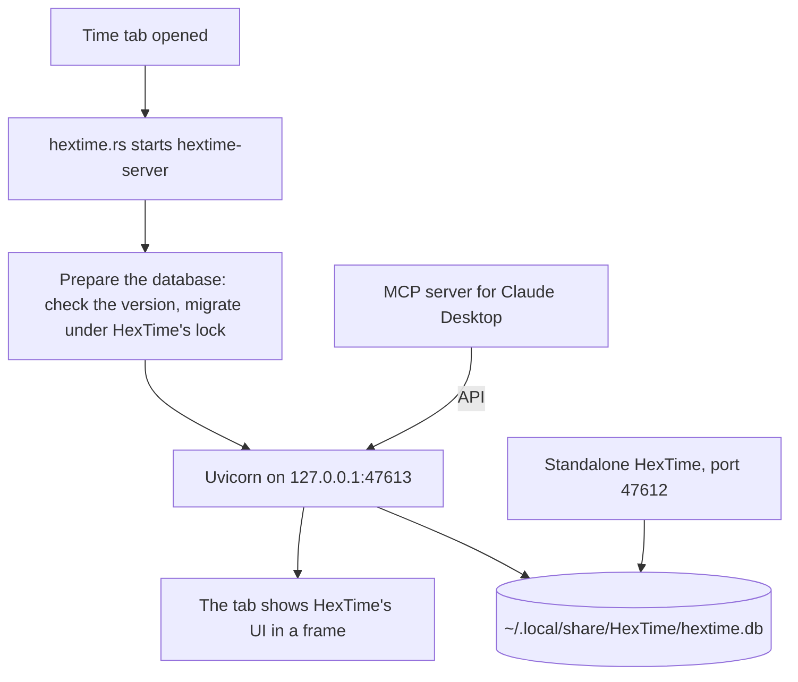

# Time tracking

The Time tab is [HexTime](hextime/index.md), the same app as the standalone HexTime desktop version. Its code is not copied here: it is developed in its own repository and built into HexStickyNote as a separate program, a *sidecar*.

## How it runs



- HexTime starts the first time the Time tab is opened and stops when HexStickyNote quits. It also stops by itself if HexStickyNote crashes, because it watches its standard input.
- If a HexTime is already answering on port 47613 (one started by the MCP server, say), the tab uses it.
- The data is HexTime's own database, **shared with the standalone HexTime**. Both can be open at once.
- PDF exports go through HexTime's save bridge into the Downloads folder, because the app window does not allow ordinary downloads.

## Keeping it up to date

The bundled HexTime must never be older than the newest HexTime that has opened the database. When HexTime gets a new database migration, build a new HexStickyNote package as well. HexStickyNote never changes a database written by a newer HexTime.

The sidecar is built from whatever is checked out in `../HexTime` (or `HEXTIME_DIR`), uncommitted changes included:

```bash
npm run build:hextime     # sidecar only, into src-tauri/binaries/
npm run build:full        # sidecar and the app
```

The contract between the two repositories is small: `app.main:app` and `GET /api/v1/config`. If HexTime changes either, `sidecar/hextime/hextime_server.py` changes with it.

## When it does not start

The tab shows the reason and a **Retry** button. The sidecar reports a database problem with its exit code; the MCP server gives the same reasons.

| Message | Exit code | What to do |
| --- | --- | --- |
| Your time tracking data was saved by a newer HexTime | 10 | Update HexStickyNote |
| The HexTime desktop app is open and uses an older version of your data | 11 | Close the standalone HexTime and retry; it was migrating the database |
| HexTime could not open its database | 12 | Check the folder with `hextime.db`: disk full or read-only? |
| HexTime is not bundled with this build | – | The package was built without the sidecar: use `npm run build:full` |
| HexTime did not start within 30 seconds | – | Start HexStickyNote from a terminal to see HexTime's output |

Database preparation copies HexTime's own startup: the SQLite file is checked and migrated before the server starts, and `hextime.lock` next to the database is held only while migrating, so the standalone app and the Time tab never migrate at the same time.

Everything else about HexTime, from its rules to running it on a server, is in the [HexTime section](hextime/index.md).
