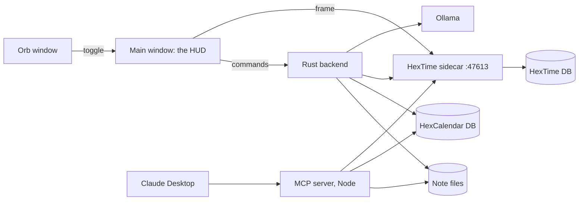

# Architecture

HexStickyNote is a [Tauri 2](https://tauri.app) app: a Rust backend and a Svelte frontend shown in the system's web view (WebKitGTK on Linux, WebView2 on Windows). This page is a short overview for someone who wants to understand or change the code.

## Three apps in one

| Part | Where the code is | Data |
| --- | --- | --- |
| Notes | This repository | Markdown files |
| Calendar (HexCalendar) | Copied into this repository and developed here: `src-tauri/src/calendar/`, `src/lib/calendar/` | HexCalendar's SQLite database, shared with the standalone HexCalendar |
| Time tracking (HexTime) | Its own repository; built in as a sidecar program ([Time tracking](Time-tracking.md)) | HexTime's SQLite database, shared with the standalone HexTime |

On top of these sit the [AI assistant](Assistant.md), which uses all three through Ollama, and the [MCP server](Claude-Desktop.md), which gives Claude Desktop the same reach.



## Windows

There are two windows. The **orb** is the small round button, always on top; the **main window** holds the HUD and is shown and hidden by the orb. The main window is created in code (`src-tauri/src/downloads.rs`) rather than from `tauri.conf.json`, because it needs a script injected into every frame for HexTime's PDF downloads. On Linux the app turns off WebKitGTK's DMABUF renderer, which shows blank transparent windows on many setups (NVIDIA and Wayland in particular).

## The backend

`src-tauri/src/`:

| Module | Does |
| --- | --- |
| `main.rs`, `commands.rs` | Start-up and the commands the frontend calls |
| `card_manager.rs` | Notes: reading and writing the Markdown files, folders |
| `calendar/` | HexCalendar: database, queries, reminders |
| `hextime.rs` | Starting, reusing and stopping the HexTime sidecar |
| `assistant/` | The assistant: the chat loop with Ollama (`mod.rs`) and its tools (`tools.rs`) |
| `ollama.rs` | Listing and downloading Ollama models |
| `claude_mcp.rs` | Adding HexStickyNote to Claude Desktop's configuration |
| `downloads.rs` | The main window and saving HexTime's PDFs |
| `settings_manager.rs`, `window_state.rs` | Settings and window positions |

The assistant's backend keeps no conversation: the frontend sends the whole chat each time. Reading tools run at once; a writing tool comes back to the frontend as a pending action and runs only after `assistant_confirm`.

## The frontend

SvelteKit with the static adapter, Svelte 5. `src/routes/` has the two windows (`+page.svelte` for the HUD, `orb/` for the button). `src/lib/components/` holds the HUD and its parts (`CardCarousel`, `NoteGrid`, `FolderMenu`, `AssistantPanel`, `HexTimeView`, `Settings`), and `src/lib/stores/` the state (`cardStore`, `assistantStore`, `settingsStore`). The calendar under `src/lib/calendar/` uses runes and keeps its styles under `.hexcal`.

## Notes on disk

Each note is a Markdown file with YAML front matter:

```markdown
---
id: 8f0c2a8e-…
created_at: 1791137307
updated_at: 1791144779
---
# Shopping list

- milk
```

The file is named after the first heading, with `(2)`, `(3)` added when the name is taken, and renamed when the heading changes. A folder is a subdirectory of the notes directory, one level deep. The note's id is in the file, so the app, the MCP server and a file manager can all move and rename files without losing track of a note.

## Where the data is

On Linux:

| Data | Path |
| --- | --- |
| Notes | `~/.local/share/hexstickynote/cards/` |
| Settings, window positions | `~/.config/hexstickynote/` |
| Calendar | `~/.local/share/com.hexcalendar.app/hexcalendar.db` |
| Time tracking | `~/.local/share/HexTime/hextime.db` |
| Claude Desktop configuration | `~/.config/Claude/claude_desktop_config.json` |

All of them follow `XDG_DATA_HOME` and `XDG_CONFIG_HOME`, which is how the tests and manual testing keep away from real data ([Development and testing](Run.md#testing-without-your-own-data)).

## Security

| Risk | How it is handled |
| --- | --- |
| Instructions hidden in data (prompt injection): a note, an event invitation or a time entry that talks to the assistant | The system prompt tells the model that tool results are data, never requests. Every change still waits for approval, and the approval card shows the full text that would be saved, not just a title. The assistant has no delete tool and no network access beyond the app's own data. A test with a real model (`real_model_does_not_follow_instructions_hidden_in_data`) checks that an event description with orders is reported, not obeyed. |
| A web page in the browser calling the local HexTime on `127.0.0.1` | The sidecar serves only requests addressed to `127.0.0.1` or `localhost` (against DNS rebinding) and refuses changes without the `X-HexTime-CSRF` header, which another site cannot add. HexTime's UI, the assistant and the MCP server send it. |
| A link in a note or an answer replacing the app with a web page | The main window loads only the app and HexTime. Web links open in the browser; other schemes (`file:` and the like) are blocked. |
| Script in Markdown | Notes and answers are rendered through DOMPurify; the content security policy allows no remote scripts, images or connections. |
| Remote pages using the app's commands | The capabilities in `src-tauri/capabilities/` list no remote URLs, so pages from other origins (HexTime's frame included) cannot call Tauri commands. |
| Paths from the frontend or the MCP server | Folder and file names are cleaned (no `/`, `\`, `..`, hidden or Windows device names); a folder is renamed or deleted only if it exists in the notes directory. PDFs from HexTime are saved only as new `.pdf` files that start with `%PDF-`, in Downloads. |

## Repository

```
src/            the Svelte frontend (routes/, lib/components/, lib/stores/, lib/calendar/)
src-tauri/      the Rust backend, Tauri configuration, the bundled MCP server (resources/)
mcp-server/     the MCP server for Claude Desktop (TypeScript)
sidecar/        the HexTime launcher and its build script
packaging/      the Arch Linux package
scripts/        sync-hextime-docs.sh
docs/           these pages (MkDocs)
```
