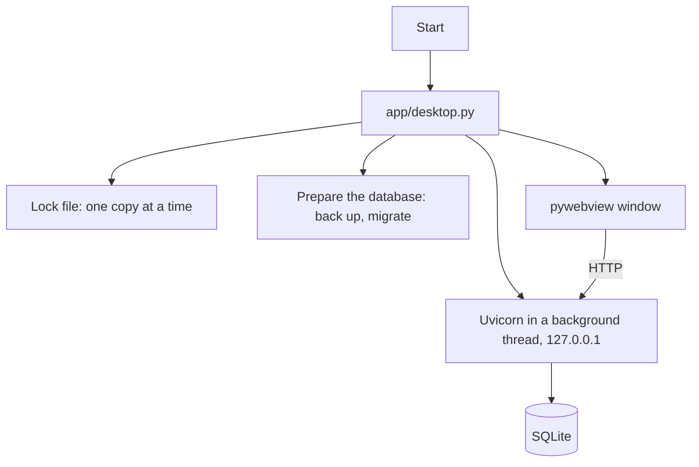
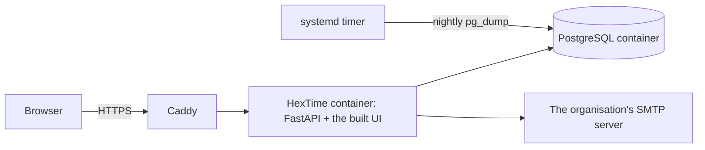

# Architecture

HexTime is one codebase that runs in two ways. This page is a short overview for someone who wants to understand or change the code.

## Two modes

The mode is one setting, `APP_MODE`. The code is the same; only the settings and the visible features change. The frontend does not know the mode in advance: it asks `GET /api/v1/config` when it starts.

| | `local` (desktop) | `server` (organisation) |
| --- | --- | --- |
| Users | One default user, no sign-in | Many; email and password, limited to one email domain |
| Database | SQLite in the user's data directory | PostgreSQL |
| Teams and invitations | Hidden | Available |
| Window | pywebview (a native window) | The browser |
| Distribution | A desktop package | Podman containers |
| Network | `127.0.0.1` only | HTTPS behind Caddy |

Every time entry, project and tag has an owner from the start, also in local mode, where the owner is always the one default user. That is why teams could be added for the server without changing the data model underneath.

## The desktop app



The SQLite file is copied before a migration, and a database written by a newer version of HexTime is left untouched with a message to update. A second launch asks the running copy to bring its window forward instead of opening another.

## The server



The containers run under an ordinary user with rootless Podman, as Quadlet units that systemd starts and restarts. `deploy/hextime-install.sh` installs and updates everything; see [Installing on a server](Install-server.md). The HexTime container waits for the database, migrates once, then serves.

## The backend

Python 3.13, FastAPI, SQLAlchemy 2.0 and Alembic, Pydantic v2.

| Layer | Folder | Does |
| --- | --- | --- |
| Routes | `app/api/` | HTTP: parse the request, check permissions through dependencies, call a service. No SQL. |
| Schemas | `app/schemas/` | Pydantic models for requests and responses |
| Services | `app/services/` | The rules: entries, the timer, reports, teams, accounts, ownership |
| Models | `app/models/` | SQLAlchemy tables |
| Core | `app/core/` | Settings, the database session, security, CSRF, email, translations |
| Reports | `app/reports/` | PDF data and layout (ReportLab) |

Services take the database session and the settings as arguments, so tests call them directly without HTTP. Who may see or change what is decided in one module, `app/services/ownership.py`. The API lives under `/api/v1/`, and FastAPI serves its documentation at `/api/docs`. Errors have one shape, `{"error": {"code": "...", "message": "..."}}`, and the frontend translates the code.

## The frontend

Svelte 5 (runes), Vite and TypeScript, served by FastAPI as static files. It uses relative URLs, so the same build works in the desktop window and in a browser. Every API call goes through `src/lib/api/`; all visible text comes from `src/lib/i18n/{fi,en}.json`, and all colours from theme tokens. Charts are Apache ECharts.

## Rules the code keeps

- **Times are UTC** in the database. Days are the user's local days, by time zone name, so daylight saving changes are handled.
- **A duration is computed**, never stored: `ended_at - started_at`. No `ended_at` means the timer is running; there is at most one per user.
- **Money is never a float.** Prices are integer cents, sums are `Decimal`, and only the final amount is rounded.
- **The rate is copied** into each entry when it is created, so changing a project's rate does not change old entries.
- **Projects, tasks and tags are archived**, not deleted, so old entries stay whole.
- **One source of numbers.** Every view, chart and PDF gets its sums from `app/services/reports.py`; the frontend never adds anything up.
- **Entries are private.** Nobody sees anyone else's entries, not a team lead and not the administrator. A team sees only each member's total hours on the team's projects, over whole days in the organisation's time zone (`TIME_ZONE`).

## Data

Thirteen tables: `users`, `teams`, `team_members`, `team_invitations`, `projects`, `tasks`, `tags`, `time_entries`, `time_entry_tags`, `audit_log` (every change to an entry), `sessions`, `login_attempts` and `account_tokens` (one-time email links, stored hashed). Schema changes are Alembic migrations that must run on both SQLite and PostgreSQL; the tests run them on both.

## Repository

```
backend/    the FastAPI app (app/), migrations (alembic/), tests
frontend/   the Svelte app (src/), Playwright tests (e2e/)
packaging/  the desktop builds: PyInstaller, the Linux install script, the .deb
deploy/     the container, Caddy, Quadlet units, backups, the installation script
docs/       these pages (MkDocs)
scripts/    dev-server.sh: server mode on your own machine with demo data
```
