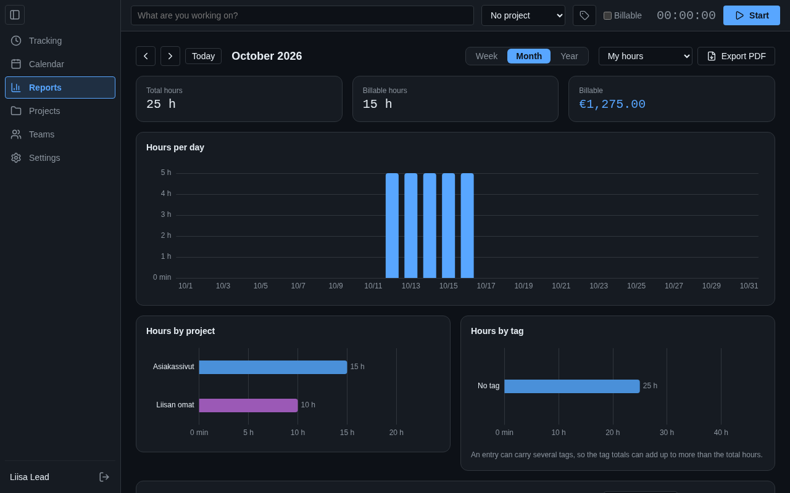

# HexTime

!!! note "From the HexTime repository"
    These pages are copied from HexTime (f57df5a) by `scripts/sync-hextime-docs.sh`;
    edit them in the HexTime repository. Paths such as `deploy/` or `backend/` refer to
    that repository. How HexStickyNote runs HexTime is described in
    [Time tracking](../Time-tracking.md).

Time tracking for one person on their own computer, or for a whole organisation on its own server. One codebase, two ways to run it.

| Page | For |
| --- | --- |
| [Architecture](architecture.md) | How the code is put together, and the rules it keeps |
| [Development and testing](Run.md) | Running HexTime from the source, server mode on your own machine, the tests, building the desktop app |
| [Installing on a server](Install-server.md) | The administrator who installs and looks after HexTime for an organisation |
| [Running the server](Server-admin.md) | Updates, backups, troubleshooting and securing the server |
| [Server logs](Logs.md) | Following what HexTime does on a server |
