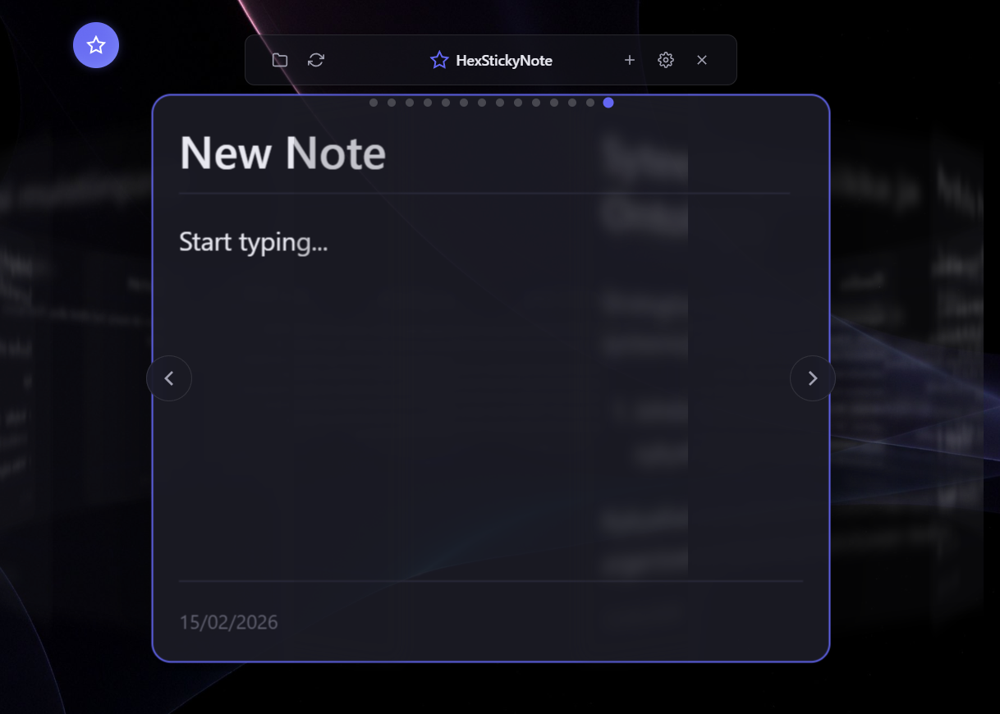

# HexStickyNote

Sticky notes, a calendar and time tracking in one desktop app, with an AI assistant that runs on your own computer. A small floating button opens the workspace; your data stays on your machine.

| Page | For |
| --- | --- |
| [Using HexStickyNote](Usage.md) | The button, notes and folders, the calendar, the time tab and the keys |
| [AI assistant](Assistant.md) | Asking about your notes, events and hours, and approving its changes |
| [Claude Desktop](Claude-Desktop.md) | Letting Claude Desktop read and change the same data through MCP |
| [Time tracking](Time-tracking.md) | How HexTime runs inside HexStickyNote, and what to do when it does not start |
| [Architecture](architecture.md) | How the code is put together, and where the data lives |
| [Development and testing](Run.md) | Running from the source, the tests, testing without touching your own data |
| [Building and installing](Install.md) | Building the packages and installing them on Linux |
| [HexTime](hextime/index.md) | HexTime's own documentation, also for its server version |
| [These pages](documentation.md) | Running this documentation locally |
